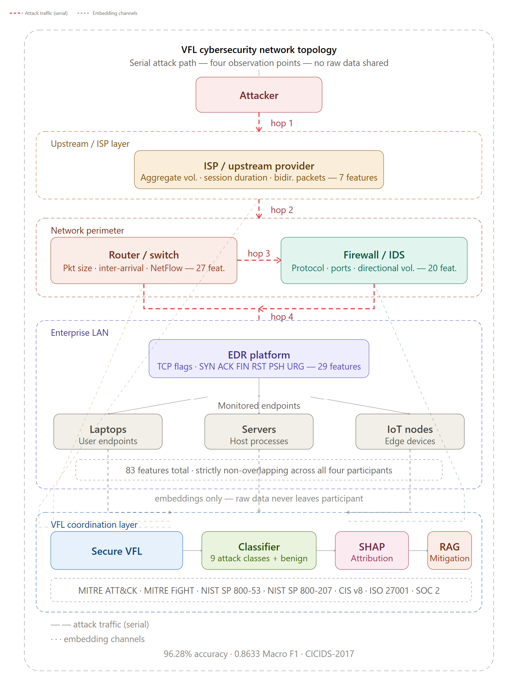
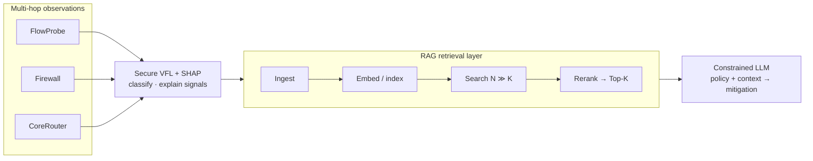

# CyberRerankBench

**Evaluating rerankers for cybersecurity RAG in an agentic VFL-NIDS pipeline**

[](https://www.python.org/downloads/)
[](https://pytorch.org/)
[](LICENSE)
[](https://ieee-dataport.org/documents/unified-multimodal-network-intrusion-detection-systems-dataset)
[](https://github.com/slundberg/shap)
[](https://www.langchain.com/)

Retrieval-Augmented Generation (RAG) improves Large Language Model (LLM) reliability in cybersecurity by grounding responses in external knowledge. Effectiveness depends on retrieved context quality, where **reranking models** play a key role. Rerankers have not been systematically evaluated in cybersecurity-specific settings, which involve noisy logs, semantically overlapping attack patterns, and policy-driven reasoning.

**CyberRerankBench** is a benchmark for evaluating rerankers in cybersecurity RAG systems. It is implemented in an agentic Network Intrusion Detection System (NIDS) pipeline that integrates:

- **Vertical Federated Learning (VFL)** for data-local detection across distributed enterprise domains (**FlowProbe**, **Firewall**, **CoreRouter**)
- **SHAP-based attribution** for explainability
- **Constrained LLM reasoning** grounded in a multi-framework cybersecurity knowledge base (MITRE ATT&CK, NIST SP 800-53, CIS Controls v8, ISO/IEC 27001)

Retrieval queries are built dynamically from detection outputs and attribution signals, so ranking strategies are scored under realistic, domain-aware conditions.

**Keywords:** information retrieval, Retrieval-Augmented Generation, reranking, benchmark evaluation, cybersecurity, intrusion detection

## Overview

| Theme | What it delivers |
|-------|------------------|
| **CyberRerankBench** | Head-to-head evaluation of retrieval and reranking under cybersecurity RAG constraints. |
| **Agentic NIDS pipeline** | Detection → attribution → retrieval query → ranked context → constrained mitigation plan. |
| **NIDS device model** | Three-party VFL: FlowProbe (access), Firewall (perimeter), CoreRouter (backbone). |
| **Vertical feature partitioning** | Flow features stay local to each domain party; only embeddings are shared. |
| **Privacy-preserving VFL** | Joint classification without exchanging raw telemetry. |
| **SHAP explainability** | Per-party attributions that both explain detections and drive RAG queries. |
| **Policy-grounded RAG** | LLM action plans constrained by retrieved controls from ATT&CK, NIST, CIS, and ISO/IEC 27001. |

<p align="center">
  
</p>

<p align="center"><em>Conceptual topology: serial attack path across observation points; embeddings only — raw data never leaves a participant. Detection, SHAP attribution, and RAG mitigation run in the coordination layer over a multi-framework knowledge base.</em></p>



## Benchmark design

CyberRerankBench evaluates **ten retrieval configurations** across **three tracks**:

| Track | Configurations | What it isolates |
|-------|----------------|------------------|
| **Policy corpus** | 6 MiniLM modes | Stage-1 retriever × Stage-2 reranker on the multi-framework policy KB. |
| **Domain-index ablation** | 2 SecureBERT FAISS modes | Effect of a cyber bi-encoder index vs. MiniLM dense retrieval. |
| **Response playbook** | 2 modes | Ranking over operational playbook-style corpus vs. policy text. |

On **CICIDS-2017** the protocol reports **250 stratified inference scenarios per track** (5 classes × 50 samples; **2,500 mode–scenario rows** when ten modes are scored). Queries are constructed from VFL labels, confidence, and SHAP attributions (party contributions and top indicators per device).

This repository currently runs the **eight-mode** ablation (six MiniLM FAISS modes + two SecureBERT FAISS modes) end to end in `Plan.ipynb` / `Score.ipynb`.

### Scoring protocol

Scoring uses a **three-layer** protocol with headline MiniLM metrics plus parallel grades from CySecBERT, CTI-BERT, and SecureBERT (`utils/cyber_encoders.py`, `utils/rag_retrieval_scores.py`):

**Layer 1 — Retrieval:** Recall@10 and nDCG@10 per encoder (`0.5·ROUGE-1 + 0.5·encoder cosine`).

**Layer 2 — Retrieval → LLM:** Context cosine + CRAG (reference vs retrieved top-10); utilization cosine + CRAG (retrieved context vs `agent_guidance`).

**Layer 3 — LLM alone:** Reasoning cosine + CRAG (`agent_guidance` vs reference); BERTScore F1.

| Headline metric | Role |
|-----------------|------|
| **Recall@10** | Graded-relevance recall of the top-10 vs. the 100-chunk Stage-1 pool |
| **nDCG@10** | Ranking quality over the same graded relevances |
| **RI_SBert / CRAG** | Context grounding vs. a label-derived reference from device descriptions |
| **Util_SBert / Util_CRAG** | How much retrieved evidence the LLM actually used |
| **LLM_SBert / LLM_CRAG / BERTScore-F1** | Reasoning quality vs. the same reference |

Cyber-encoder columns use `_*_cysecbert`, `_*_ctibert`, and `_*_securebert` suffixes. Exports include `rerank_method_averages_cyber.csv` per class.

### Retrieval / reranking modes (this repository)

All two-stage modes use a **100-chunk Stage-1 shortlist** and keep the **top 10** for the LLM:

| Mode | Stage 1 (100) | Stage 2 (10) |
|------|----------------|--------------|
| `none` (Dense MMR) | MiniLM FAISS multi-query | MMR |
| `bm25` | BM25 over full child corpus | truncate |
| `doct5query` | BM25 over doc2query-expanded corpus (`castorini/doc2query-t5-base-msmarco`, 20 synthetic queries / chunk) | truncate |
| `crossencoder` (Dense → CE) | MiniLM FAISS top-100 (no MMR) | CrossEncoder (`ms-marco-MiniLM-L-6-v2`) |
| `bm25_crossencoder` (BM25 → CE) | BM25 top-100 | CrossEncoder |
| `colbert` (Dense → ColBERT) | MiniLM FAISS top-100 (no MMR) | ColBERT v2 late-interaction |
| `none_securebert` | SecureBERT FAISS multi-query | MMR |
| `crossencoder_securebert` | SecureBERT FAISS top-100 | CrossEncoder (same CE as above) |

## Findings

On CICIDS-2017, under the three-track protocol:

- On the **policy corpus** track, **dense MiniLM retrieval still leads on faithfulness**.
- The **response playbook** track **raises pool recall** but **weakens utilization** proxies (retrieved text is broader than what the LLM actually uses).
- **Cyber-encoder grades reorder modes** relative to MiniLM and expose **encoder–corpus mismatch**.
- **No single reranker dominates** across attack classes or encoders.
- **Class- and encoder-conditioned routing** is treated as a hypothesis for future work, not a settled conclusion.

## Project structure

```
VFL-RAG/
├── datasets/              # CICIDS-2017 CSV (not committed)
├── model/                 # Trained models (created after training)
│   ├── vfl_model_best.pth
│   ├── meta_model_best.pth
│   ├── model_metadata.json
│   └── scaler*.pkl
├── utils/                 # Core modules
│   ├── model_utils.py     # VFL / meta-model PyTorch modules
│   ├── vfl_utils.py       # Feature partition and VFL helpers
│   ├── label_config.py    # 5-class training policy
│   ├── pipeline_paths.py  # input/ → output/inference|plans|scores
│   ├── cyber_encoders.py  # CySecBERT / CTI-BERT / SecureBERT graders
│   ├── rag_utils.py       # Predictions/config, FAISS, rerank reports
│   └── rag_index_build.py # Sectioned PDF ingest, parent/child index
├── RAG_docs/              # Knowledge base and RAG artifacts
│   ├── agentic_features.json
│   ├── attack_options.json
│   ├── knowledge/         # Policy PDFs (ATT&CK, NIST, CIS, ISO, …)
│   ├── vector_store/      # FAISS (all-MiniLM-L6-v2) + rag_parents.json
│   └── vector_store_securebert/  # Parallel FAISS (SecureBERT 2.0 bi-encoder)
├── input/                 # Per-class inference CSVs (Predict.ipynb)
│   ├── BENIGN/samples.csv
│   ├── DDOS/samples.csv
│   └── ...                # DOS, PORTSCAN, FTPPATATOR (50 rows each)
├── output/                # Run artifacts
│   ├── inference/<CLASS>/ # Predictions + SHAP JSON
│   ├── plans/<CLASS>/     # Eight-mode rerank reports
│   └── scores/<CLASS>/    # Per-class scoring + combined summary
├── outputs/               # Training comparison JSON
├── scripts/               # Pipeline patches, I/O helpers, audits
├── Documents/             # Pipeline and RAG guides
├── docs/                  # Architecture diagrams
├── CyberRank.png          # Topology figure
├── Train.ipynb
├── Predict.ipynb
├── Index.ipynb
├── Plan.ipynb
├── Score.ipynb
├── LLM_Runtime_Benchmark.ipynb
└── requirements.txt
```

## Quick Start

### System Requirements

- **OS**: Windows 10/11, Linux (Ubuntu 18.04+), or macOS 10.14+
- **Python**: 3.8 or higher (3.12 recommended; ColBERT/`voyager` wheels are most reliable on 3.12)
- **RAM**: 8GB minimum (16GB recommended)
- **Storage**: ~2GB free space
- **GPU**: Optional (NVIDIA GPU with CUDA 11.8+ for acceleration)

### Installation

```bash
# 1. Clone repository
git clone <repository-url>
cd VFL-RAG

# 2. Create virtual environment
python -m venv .venv
.venv\Scripts\activate  # Windows
# source .venv/bin/activate  # Linux/Mac

# 3. Upgrade pip
python -m pip install --upgrade pip

# 4. Install dependencies
pip install -r requirements.txt

# 5. Install PyTorch with GPU support (optional)
# For CUDA 11.8:
pip install torch torchvision torchaudio --index-url https://download.pytorch.org/whl/cu118
# For CUDA 12.1:
pip install torch torchvision torchaudio --index-url https://download.pytorch.org/whl/cu121

# 6. Download NLTK data
python -c "import nltk; nltk.download('punkt')"
```

### Dataset Setup

```bash
# Create datasets directory
mkdir datasets

# Download from IEEE DataPort (requires subscription/login)
# After downloading, extract and locate: undersampled_CIC2017_dataset.csv
# Copy to datasets/ directory:
# Windows:
copy "path\to\undersampled_CIC2017_dataset.csv" datasets\
# Linux/macOS:
cp path/to/undersampled_CIC2017_dataset.csv datasets/

# Verify
dir datasets\*.csv  # Windows
ls datasets/*.csv   # Linux/macOS
```

IEEE DataPort subscription required. See [Dataset](#dataset) below.

Build per-class inference CSVs (50 rows × 5 classes):

```bash
python scripts/build_input_class_csvs.py
```

### Configuration

Create a `.env` file for OpenAI (required for action-plan generation):

```env
OPENAI_API_KEY=sk-your-api-key-here
```

**Get API Key**: [OpenAI Platform](https://platform.openai.com/api-keys)

### Verification

```python
# Test imports
python -c "from utils.model_utils import VFLModel; from utils.vfl_utils import load_agent_definitions; print('Setup OK')"

# Test PyTorch
python -c "import torch; print(f'PyTorch: {torch.__version__}'); print(f'CUDA: {torch.cuda.is_available()}')"
```

## Notebooks workflow

Execute notebooks in this order:

```
Train.ipynb  →  Predict.ipynb  →  Index.ipynb  →  Plan.ipynb  →  Score.ipynb
```

Detection and attribution produce the queries; indexing builds MiniLM and SecureBERT stores; planning runs the eight-mode ablation; scoring computes three-layer MiniLM + cyber-encoder metrics.

Optional: `LLM_Runtime_Benchmark.ipynb` for generation latency.

### 1. Train.ipynb (Training)

**Purpose**: Train VFL and standard neural network baseline models.

**What it does**:
- Loads `undersampled_CIC2017_dataset.csv` from `datasets/`
- Trains on **5 classes** (BENIGN, DDOS, DOS, PORTSCAN, FTPPATATOR); see `utils/label_config.py`
- Partitions features into FlowProbe (23), Firewall (32), CoreRouter (42) per `agentic_features.json`
- Trains the VFL classifier with vertical federated learning
- Trains a standard neural network baseline
- Trains a meta-model for efficient SHAP computation
- Computes SHAP values and party-level attributions used later as retrieval signals

**Inputs**:
- `undersampled_CIC2017_dataset.csv` in `datasets/`
- `RAG_docs/agentic_features.json` (party definitions)

**Outputs**:
- `model/vfl_model_best.pth` — trained VFL model
- `model/meta_model_best.pth` — meta-model for SHAP
- `model/model_metadata.json` — model configuration
- `model/scaler*.pkl` — feature scalers
- `model/shap_background.npy` — SHAP background data
- `outputs/vfl_shap_performance_*.csv` — performance metrics
- `outputs/model_comparison_*.json` — model comparison results

**Execution Time**: 30–60 minutes (depending on hardware)

**Configuration**:
```python
embed_dim = 64
hidden_dim = 128
num_classes = 5
epochs = 100
learning_rate = 0.001
```

**Run**:
```bash
jupyter notebook Train.ipynb
```

---

### 2. Predict.ipynb (Inference)

**Purpose**: Generate explainable predictions for new network flows.

**What it does**:
- Loads trained models from `model/`
- Processes per-class CSVs under `input/<CLASS>/samples.csv`
- Generates predictions with confidence scores
- Computes SHAP values per prediction
- Identifies the dominant party per prediction (used in RAG query construction)

**Prerequisites**: Must run `Train.ipynb` first

**Inputs**:
- Trained models in `model/`
- Per-class CSVs under `input/<CLASS>/samples.csv` (50 rows per class)
- Build or refresh: `python scripts/build_input_class_csvs.py`
- 250 rows total when all five classes are present

**Outputs**:
- `output/inference/<CLASS>/predictions_*.json` — predictions with SHAP values (per attack class)

**Execution Time**: 1–5 minutes (depending on sample size)

**Run**:
```bash
jupyter notebook Predict.ipynb
```

---

### 3a. Index.ipynb (RAG index)

**Purpose**: Ingest the multi-framework knowledge base and persist **two** FAISS vector stores.

**What it does**:
- Loads JSON/PDF documents from `RAG_docs/knowledge/`
- **PDFs:** Per-page rows are merged into **sectioned documents** (heading heuristics), then each section is split into **semantic parents** (paragraph-embedding similarity), then into **child** chunks — see `utils/rag_index_build.py`
- **Retrieval titles:** One search-oriented title per semantic parent (default: local HF summarizer; optional extractive keyword line or LLM via `TITLE_MODE`). Child vectors embed **`retrieval_title + child text`**
- Builds MiniLM (`all-MiniLM-L6-v2`) FAISS via `utils/rag_utils.py` / `utils/rag_index_build.py`
- Builds a parallel SecureBERT 2.0 bi-encoder index (`cisco-ai/SecureBERT2.0-biencoder`) at `RAG_docs/vector_store_securebert/`
- Persists parent stores (`rag_parents.json`) for child → parent expansion in Plan

**Prerequisites**: Knowledge files in `RAG_docs/knowledge/` (representative: MITRE ATT&CK, NIST SP 800-53, CIS Controls v8, ISO/IEC 27001)

**Run** (whenever knowledge files change):
```bash
jupyter notebook Index.ipynb
```

---

### 3b. Plan.ipynb (Action planning)

**Purpose**: Generate per-device (FlowProbe / Firewall / CoreRouter) mitigation guidance from SHAP predictions, and run the **eight-mode retrieval / reranking ablation** for `Score.ipynb`.

**What it does**:
- Loads the saved MiniLM and SecureBERT FAISS indexes and parent stores from Part 1 (does not re-read `RAG_docs/knowledge/`)
- Builds retrieval queries per sample from the predicted label, confidence, party contributions, and top SHAP indicators (deterministic template, deterministic rephrase, optional LLM variants)
- For every sample, assembles context under the eight modes in the [modes table](#retrieval--reranking-modes-this-repository)
- Expands the top-10 child chunks to full parent sections via `rag_parents.json` and calls OpenAI once per mode per sample
- Persists each sample’s full comparison (top-10 + 100-chunk candidate pool + LLM `agent_guidance`) via `utils.rag_utils.save_rerank_comparison_report`
- Caches the doc2query-expanded corpus to `RAG_docs/rag_parents_doc2query.json`

**Prerequisites**:
- Part 1 completed (`RAG_docs/vector_store/` and `RAG_docs/vector_store_securebert/` exist)
- Predictions from `Predict.ipynb`
- OpenAI API key in `.env`
- `RAG_docs/attack_options.json`, `RAG_docs/agentic_features.json`

**Inputs**:
- `output/inference/<CLASS>/*.json` — predictions with SHAP (Plan loads from the five class folders; root combined dumps are ignored)
- `RAG_docs/vector_store/` and `RAG_docs/vector_store_securebert/`

**Outputs**:
- `output/plans/<CLASS>/rerank_comparison_sample_<id>_<ts>.json` — one per sample, all eight modes
- `RAG_docs/rag_parents_doc2query.json` — cached doc2query-expanded corpus

**Run**:
```bash
jupyter notebook Plan.ipynb
```

---

### 4. Score.ipynb (Evaluation)

**Purpose**: Evaluate retrieval / reranking modes from `Plan.ipynb` with BEIR / CRAG-aligned metrics at **three layers** (retrieval, retrieval→LLM, LLM alone), with parallel **cyber BERT** cosines (CySecBERT, CTI-BERT, SecureBERT 2.0).

**What it does**:
- Recursively loads `rerank_comparison_sample_*.json` from `output/plans/<CLASS>/` (keeps the **newest** file per `sample_id` when Plan was re-run)
- Each report holds all eight modes' top-10 + 100-chunk candidate pool + LLM `agent_guidance` (five classes × 50 samples = 250 reports for a full run)
- Builds a deterministic **label-derived reference string** per sample from `agentic_features.json` (FlowProbe / Firewall / CoreRouter device descriptions)
- Derives **adaptive thresholds** per batch (median / 25th-percentile of the observed score distribution, clamped to relaxed floors)
- Computes metrics per sample per mode and aggregates by rerank mode and by attack class
- Exports per-class scoring under `output/scores/<CLASS>/` plus `output/scores/scoring_results_combined.json`

**Prerequisites**: Rerank comparison reports from `Plan.ipynb`

**Inputs**:
- `output/plans/<CLASS>/rerank_comparison_sample_*.json`
- `RAG_docs/agentic_features.json`

**Outputs**:
- `output/scores/<CLASS>/scoring_results.json`
- Per-rerank-mode and per-attack-class tables
- Grouped bar charts
- `rerank_method_averages_cyber.csv` per class

**Execution Time**: 2–10 minutes (depending on number of samples)

**Run**:
```bash
jupyter notebook Score.ipynb
```

## Technologies & Tools

### Core ML/DL Framework
- **PyTorch** (≥2.0.0) — deep learning
- **NumPy** (≥1.23.0) — numerical computing
- **Pandas** (≥1.5.0) — data manipulation
- **scikit-learn** (≥1.2.0) — ML utilities

### Explainability
- **SHAP** (≥0.42.0) — SHapley Additive exPlanations

### LLM & RAG
- **OpenAI API** — constrained action-plan generation
- **LangChain** (≥0.3.0) — LLM application framework
- **FAISS** — dense vector similarity search (MiniLM and SecureBERT indexes)
- **Sentence Transformers** (≥2.2.0) — MiniLM bi-encoder + CrossEncoder reranker
- **SecureBERT 2.0 bi-encoder** (`cisco-ai/SecureBERT2.0-biencoder`) — parallel dense index
- **rank-bm25** — lexical Stage-1 retriever (`bm25`, `bm25_crossencoder`)
- **Hugging Face Transformers** + **SentencePiece** — T5 (`castorini/doc2query-t5-base-msmarco`) for `doct5query`
- **RAGatouille** — ColBERT v2 late-interaction reranker (patched CPU MaxSim kernel on Windows)

### Evaluation
- **MiniLM (`all-MiniLM-L6-v2`)** — headline SBERT cosine / graded relevance
- **CySecBERT, CTI-BERT, SecureBERT** — parallel cyber-encoder graders
- **BERTScore** (≥0.3.13) — contextual similarity of LLM reasoning vs. reference
- **ROUGE** (≥1.0.1) — lexical overlap inside graded relevance
- **NLTK** (≥3.8.0) — tokenization
- **CRAG-style proxy** — 3-valued truthfulness rescaled to `[0, 1]` with adaptive per-batch thresholds

### Data Processing
- **pypdf** — PDF ingest for the policy knowledge base

### Development
- **Jupyter Notebook** — interactive pipeline
- **Python 3.8+** (3.12 recommended)

## Dataset

### UM-NIDS Dataset (Unified Multimodal Network Intrusion Detection Systems Dataset)

**Source**: [IEEE DataPort - UM-NIDS Dataset](https://ieee-dataport.org/documents/unified-multimodal-network-intrusion-detection-systems-dataset)

The Unified Multimodal Network Intrusion Detection System (UM-NIDS) dataset integrates network flow data from CIC-IDS 2017, CIC-IoT 2023, UNSW-NB15, and CIC-DDoS 2019. This project uses the **undersampled CIC-IDS 2017** component.

**Dataset File Used**: `undersampled_CIC2017_dataset.csv`

**Key Statistics**:
- **Original Features**: 120 features (from CIC-IDS 2017)
- **VFL split**: FlowProbe 23 + Firewall 32 + CoreRouter 42
- **Training classes**: 5 (BENIGN, DDOS, DOS, PORTSCAN, FTPPATATOR) — see `utils/label_config.py`
- **Dropped from the 9-class set**: BOT, WEBATTACK, SSHPATATOR, OTHERS
- **Data Split**: 64% train, 16% validation, 20% test
- **Inference sample**: 50 stratified rows per class (250 total)

**Download**:
1. Visit [IEEE DataPort UM-NIDS Dataset](https://ieee-dataport.org/documents/unified-multimodal-network-intrusion-detection-systems-dataset)
2. Login/Subscribe to IEEE DataPort (IEEE members have free access)
3. Download "Undersampled version of all four datasets with same feature space" (394.19 MB)
4. Extract and locate `undersampled_CIC2017_dataset.csv`
5. Place in `datasets/` directory

**Citation**:
```
Irfan Khan, Nathaniel Bastian, Syed Wali, Yasir Ali Farrukh,
"Unified Multimodal Network Intrusion Detection Systems Dataset",
IEEE Dataport, October 2, 2024, doi:10.21227/d8at-gb29
```

**Original CIC-IDS 2017 Citation** (for reference):
```
Iman Sharafaldin, Arash Habibi Lashkari, and Ali A. Ghorbani,
"Toward Generating a New Intrusion Detection Dataset and Intrusion Traffic Characterization",
4th International Conference on Information Systems Security and Privacy (ICISSP), Portugal, 2018
```

## Results

### Detection (VFL)

| Model | Accuracy | Macro Recall | Macro F1 |
|-------|----------|--------------|----------|
| **VFL** | 0.9617 | 0.9864 | 0.8594 |
| **Standard NN** | 0.9643 | 0.9863 | 0.8734 |

VFL matches centralized accuracy while keeping raw flows local to each party.

### Agent contributions (SHAP)

- **FlowProbe**: access-path flow telemetry
- **Firewall**: perimeter inspection features
- **CoreRouter**: backbone bidirectional aggregates

These attributions are injected into RAG queries so retrieval is conditioned on *which domain evidence drove the detection*, not only the predicted class.

### Reranking (CyberRerankBench)

See [Findings](#findings). Dense MiniLM remains strongest on policy-corpus faithfulness; playbook retrieval lifts pool recall at the cost of utilization; cyber-encoder graders disagree with MiniLM and with each other. No mode wins uniformly across classes or encoders.

## Troubleshooting

### Common Issues

**Import Errors**:
```bash
# Ensure you're in project root
cd /path/to/VFL-RAG

# Verify utils directory exists
# Reinstall if needed
pip install -r requirements.txt
```

**CUDA/GPU Issues**:
```python
import torch
print(torch.cuda.is_available())  # Should be True
# If False, reinstall PyTorch with CUDA support (see Installation)
```

**Dataset Not Found**:
- Verify CSV files are in `datasets/`
- Check file names (should be `.csv`)
- Run notebooks from the project root
- For Predict: `python scripts/build_input_class_csvs.py` and confirm `input/<CLASS>/samples.csv`

**OpenAI API Errors**:
- Verify `.env` exists in the project root
- Check API key format: `OPENAI_API_KEY=sk-...`
- Ensure no extra spaces or quotes
- Test: `python -c "from dotenv import load_dotenv; import os; load_dotenv(); print('OK' if os.getenv('OPENAI_API_KEY') else 'Missing')"`

**Memory Issues**:
- Reduce batch size in the training notebook
- Use a smaller dataset subset for testing
- Close other applications
- Consider CPU if GPU memory is limited

**NLTK Data Missing**:
```python
import nltk
nltk.download('punkt')
```

**ColBERT on Windows**:
- Use Python 3.12 (RAGatouille/`voyager` has no cp313 wheels)
- First ColBERT load JIT-builds a torch extension; install MSVC “Desktop development with C++” and keep `ninja` on PATH

## Contributing

Contributions are welcome. Please follow these guidelines.

### How to Contribute

1. **Fork and Clone**:
   ```bash
   git clone https://github.com/your-username/VFL-RAG.git
   cd VFL-RAG
   git remote add upstream https://github.com/original-owner/VFL-RAG.git
   ```

2. **Create Branch**:
   ```bash
   git checkout -b feature/your-feature-name
   ```

3. **Make Changes**:
   - Follow PEP 8
   - Add type hints to functions
   - Include Google-style docstrings
   - Update documentation as needed

4. **Test Changes**:
   ```bash
   python -c "from utils.model_utils import VFLModel; print('Imports OK')"
   ```

5. **Commit and Push**:
   ```bash
   git add .
   git commit -m "Add: brief description"
   git push origin feature/your-feature-name
   ```

6. **Create Pull Request** on GitHub

### Coding Standards

- **Style**: PEP 8 (4 spaces, max 100 chars per line)
- **Naming**: `snake_case` for functions, `PascalCase` for classes
- **Type Hints**: Include for all function signatures
- **Docstrings**: Google-style
- **Formatting**: Use `black`

### Reporting Bugs

Include:
- Clear title and description
- Steps to reproduce
- Expected vs actual behavior
- Environment details (OS, Python version, package versions)
- Error messages and stack traces

### Suggesting Enhancements

Include:
- Clear description
- Use case and rationale
- Proposed solution (if available)
- Alternatives considered

## License

This project is licensed under the MIT License.

## Acknowledgments

- **UM-NIDS Dataset**: [IEEE DataPort](https://ieee-dataport.org/documents/unified-multimodal-network-intrusion-detection-systems-dataset) (doi:10.21227/d8at-gb29)
- **CICIDS-2017**: [Canadian Institute for Cybersecurity](https://www.unb.ca/cic/datasets/ids-2017.html)
- **SHAP**: [SHapley Additive exPlanations](https://github.com/slundberg/shap)
- **LangChain**: [LangChain Framework](https://www.langchain.com/)
- **PyTorch**: [PyTorch](https://pytorch.org/)
- Policy corpora: MITRE ATT&CK, NIST SP 800-53, CIS Controls v8, ISO/IEC 27001 (and related mappings in `RAG_docs/knowledge/`)

---

This project is for research and educational purposes. Handle telemetry and policy documents in line with applicable privacy and licensing constraints.
